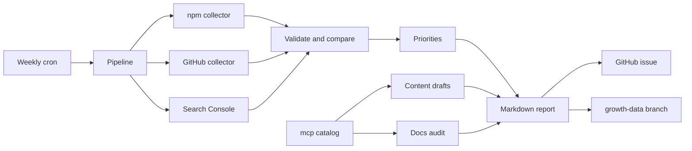

# Growth agent architecture

Zero-operating-cost weekly agent for `usethishook`. Runs as an isolated Node.js/TypeScript package under `growth/`, scheduled by GitHub Actions. No hosted database, paid automation tool, paid hosting, or paid AI API is required.

## Goals

- Increase qualified developer discovery, docs engagement, package adoption, and genuine contributions.
- Prefer observed public metrics over vanity signals.
- Produce human-reviewed drafts only. Never auto-post to LinkedIn, DEV, Reddit, or other communities.
- Never merge pull requests or publish npm releases automatically.

## Package layout

```text
growth/
  growth.config.json      # package/repo/site limits
  src/
    collectors/           # npm, GitHub, optional Search Console
    metrics/              # normalize, history, period compare
    analysis/             # prioritized actions + hypotheses
    content/              # catalog-bound drafts + optional LLM
    audit/                # docs/sitemap/link checks
    report/               # markdown + optional GitHub issue
    pipeline.ts           # weekly orchestration
    http.ts               # budgeted fetch client
  data/snapshots/         # committed JSON history (growth-data branch in CI)
  reports/                # dated markdown reports
```

## Weekly data flow

1. Fetch npm registry + download windows and GitHub public repo metrics.
2. Optionally fetch Google Search Console query rows when secrets are present.
3. Normalize into a snapshot that labels every value as observed or missing.
4. Compare current vs previous 7-day and 28-day windows when both exist.
5. Audit docs/catalog/sitemap for precise, verifiable gaps.
6. Generate one tutorial draft from `mcp/data/catalog.json` (LLM optional).
7. Write `reports/YYYY-MM-DD.md` and `data/snapshots/YYYY-MM-DD.json`.
8. Create or update a `Growth review YYYY-MM-DD` GitHub issue when `GROWTH_PUBLISH=true`.



## Safety boundaries

| Action                     | Policy                                         |
| -------------------------- | ---------------------------------------------- |
| Third-party social posts   | Draft only                                     |
| npm publish / release      | Never                                          |
| Merge pull requests        | Never                                          |
| Modify `src/` package code | Not in MVP automation                          |
| Open docs PR               | Off by default (`pullRequests.enabled: false`) |
| Secret logging             | Redacted                                       |

## Cost safeguards

- Hard cap: 25 HTTP requests per run.
- Request timeout: 10s; max 2 retries on 429/5xx.
- Stop additional GitHub calls when `x-ratelimit-remaining < 10`.
- LLM: at most 1 call, 20s timeout, capped output tokens; deterministic fallback otherwise.
- Exit 0 if optional sources fail; exit non-zero only when both npm and GitHub public collection fail or the process crashes.

## Persistence strategy

CI commits snapshots and reports to the long-lived `growth-data` branch. That keeps weekly artifacts out of `main` so the React/Node CI matrix is not retriggered by report commits.
